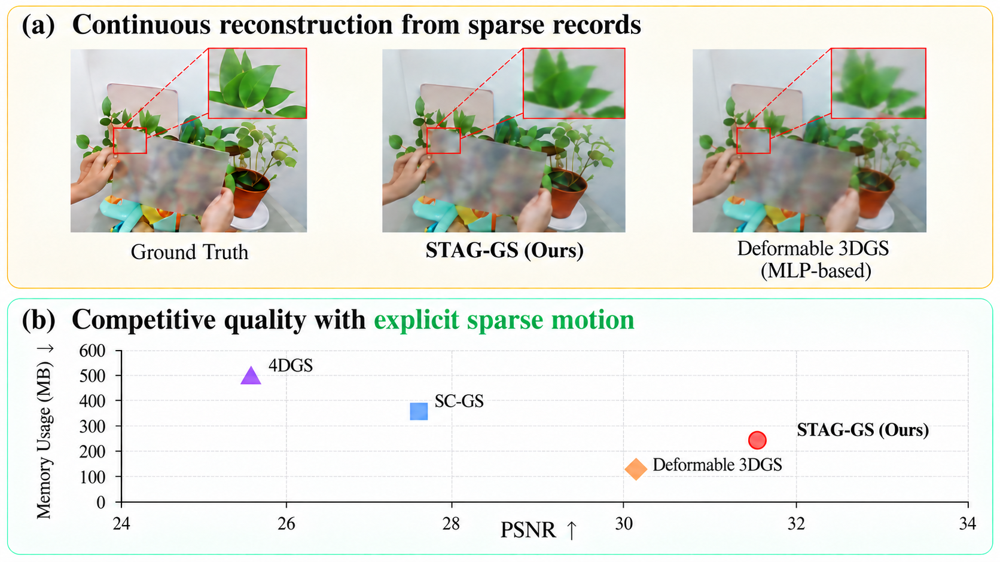

# STAG-GS

### Remember Less, Render More with Sparse Temporal Anchor-Guided Records

Reconstruct dynamic 3D scenes from image sequences and render them at new viewpoints and times.
STAG-GS learns from all training frames, but stores explicit motion changes only at sparse temporal anchors
instead of using a deformation MLP.

[Method](paper/main.tex) | [Installation](#installation) | [Quick Start](#quick-start) | [Configuration](#configuration)



## How It Works

1. **Build the scene.** Optimize canonical 3D Gaussians during a static warm-up.
2. **Learn sparse motion.** Store translation, rotation, and log-scale changes at temporal anchors.
3. **Reconstruct on demand.** Transport motion estimates from past and future anchors, combine them with confidence-weighted consensus, and render with the 3DGS rasterizer.

The goal is competitive reconstruction quality with memory-efficient, directly accessible motion records.

## Installation

Use a CUDA-capable NVIDIA GPU, Conda, Git, and a C++ build toolchain. The CUDA toolkit (`nvcc`) must match
the CUDA version used by PyTorch to compile the local rasterizer and KNN extensions.
The commands below target Python 3.10, PyTorch 2.1.2, and CUDA 12.1.

```bash
git clone --recursive https://github.com/iamkyledang/stag_gs.git
cd stag_gs

conda create -n stag_gs python=3.10 -y
conda activate stag_gs

python -m pip install torch==2.1.2 torchvision==0.16.2 --index-url https://download.pytorch.org/whl/cu121
python -m pip install numpy==1.26.4 scipy==1.11.4 opencv-python==4.10.0.84 "setuptools<81" wheel
python -m pip install --no-build-isolation -r requirements.txt
```

Already cloned without submodules? Run `git submodule update --init --recursive` before installing dependencies.

For Linux H100 machines with the repository at `/network-volume/stag_gs`,
[setup_h100.sh](setup_h100.sh) provides a dedicated installation and validation workflow:

```bash
source /network-volume/stag_gs/setup_h100.sh
```

## Quick Start

### 1. Prepare a Dataset

Download and extract a supported dataset under `datasets/`:

| Dataset | Scene format | Example scene path |
| --- | --- | --- |
| [NeRF-DS](https://jokeryan.github.io/projects/nerf-ds/) | Nerfies format with `dataset.json` | `datasets/nerf_ds/as_novel_view` |
| [D-NeRF](https://www.albertpumarola.com/research/D-NeRF/index.html) | Blender format with `transforms_train.json` | `datasets/dnerf/hook` |
| [HyperNeRF](https://hypernerf.github.io/) | Nerfies format, interpolation split | `datasets/hypernerf_interp/interp_aleks-teapot/aleks-teapot` |

Pass the scene directory, not the dataset root, to `-s`. Datasets are not downloaded automatically.

### 2. Train

```bash
# NeRF-DS
python train.py -s datasets/nerf_ds/as_novel_view -m output/as --eval --load2gpu_on_the_fly

# D-NeRF
python train.py -s datasets/dnerf/hook -m output/hook --eval --white_background
```

`-s` selects the input scene; `-m` selects the output directory. The current default is **20,000 iterations**,
including a **3,000-iteration static warm-up**.

### 3. Render and Evaluate

```bash
python render.py -m output/as --mode render --skip_train
python metrics.py -m output/as
```

Evaluation reports **PSNR**, **SSIM**, and **LPIPS**. Use the same output directory supplied during training.

To generate an interpolation sequence:

```bash
python render.py -m output/as --mode time
```

Other rendering modes include `view` (novel views), `all` (time and view interpolation),
and `original` (time and view interpolation along the captured trajectory for real-world data).

## Configuration

[configs.json](configs.json) supplies the active defaults; command-line arguments override them.
Dataset-specific configuration files are also provided in the repository. The active defaults are
not necessarily the settings used for the paper's experiments.

| Option | Purpose | Current default |
| --- | --- | --- |
| `--iterations` | Total training iterations | `20000` |
| `--warm_up` | Static warm-up iterations | `3000` |
| `--anchor_stride` | Target temporal anchor spacing, in training frames | `8` |
| `--temporal_window` | Local motion estimation window | `2` |
| `--knn_k` | Spatial neighbors used for motion estimation | `32` |
| `--lambda_rigid` | Local rigidity regularization weight | `0.3` |
| `--lambda_temporal` | Temporal smoothness regularization weight | `0.05` |
| `--lambda_scale` | Scale regularization weight | `0.3` |

For example, override the anchor spacing for a new training run:

```bash
python train.py -s datasets/nerf_ds/as_novel_view -m output/as_stride16 --eval --anchor_stride 16
```

See [arguments/__init__.py](arguments/__init__.py) for all options. Larger scenes and denser temporal anchors
can require substantially more GPU memory.

## Outputs and Code

Each experiment stores its canonical Gaussians, motion records, and rendered images under `-m`:

```text
output/as/
    cfg_args
    point_cloud/iteration_<N>/point_cloud.ply
    motion/iteration_<N>/motion.npz
    test/ours_<N>/renders/
    test/ours_<N>/gt/
```

| File | Role |
| --- | --- |
| [train.py](train.py) | Train the canonical scene and sparse motion records |
| [render.py](render.py) | Render images and interpolation sequences |
| [metrics.py](metrics.py) | Evaluate reconstruction quality |
| [scene/sparse_anchor_motion.py](scene/sparse_anchor_motion.py) | Temporal anchors, local motion estimation, and transport |
| [scene/gaussian_model.py](scene/gaussian_model.py) | Canonical Gaussian representation |
| [full_eval.sh](full_eval.sh) | Batch training, rendering, and evaluation on NeRF-DS and HyperNeRF |

To run the NeRF-DS and HyperNeRF benchmark from a Bash shell:

```bash
bash full_eval.sh output 20000
```

## Acknowledgments and License

STAG-GS builds on [Deformable-3D-Gaussians](https://github.com/ingra14m/Deformable-3D-Gaussians)
and [3D Gaussian Splatting](https://repo-sam.inria.fr/fungraph/3d-gaussian-splatting/).
We thank the authors of NeRF-DS, D-NeRF, and HyperNeRF for their datasets.

The code retains the original Inria license. See [LICENSE](LICENSE) for terms and restrictions.
